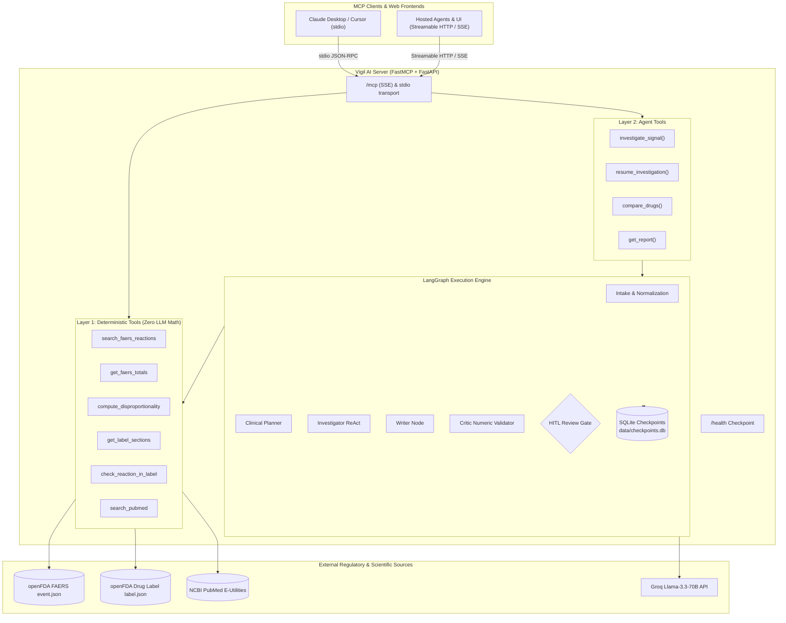

# Vigil AI 🔬
### Autonomous Pharmacovigilance & Drug Safety MCP Server

Vigil AI is a production-grade, hosted **Model Context Protocol (MCP)** server and autonomous pharmacovigilance copilot. It combines **LangGraph**, **FastMCP**, **openFDA**, **NCBI PubMed**, and **Groq** to conduct clinical adverse event signal detection with **zero LLM math** and strict regulatory audit trails.

Vigil AI exposes two complementary architectural layers to any MCP client (such as Claude Desktop, Cursor, or custom agents):
1. **Layer 1: Deterministic Pharmacovigilance Tools** — 6 low-level tools querying openFDA FAERS, official FDA prescribing labels, and PubMed, with disproportionality statistics (PRR, ROR, 95% CI, Yates' $\chi^2$) computed strictly in Python.
2. **Layer 2: Autonomous Agentic Surveillance** — 4 high-level tools running a multi-agent LangGraph pipeline (Planner $\to$ Investigator $\to$ Writer $\to$ Critic $\to$ Human Review) with SQLite checkpoint persistence and real-time MCP progress reporting.

---

## 🏛️ Key Invariants & Design Decisions

1. **Zero LLM Math Guarantee**:
   Large language models frequently hallucinate arithmetic, fractions, and confidence intervals. In Vigil AI, **all statistical metrics** (PRR, ROR, 95% Confidence Intervals, and Yates' Chi-square) are calculated strictly by Python tools. The LLM never computes or approximates statistical figures.

2. **Zero-Quota Protection for Public Hosting**:
   Zero-LLM stats and lookup tools require no API key. Caller-facing agent tools read the caller's key from the `groq_api_key` parameter, the `X-Groq-Api-Key` HTTP header, or the local `GROQ_API_KEY` environment variable.

3. **Rate Limiting & In-Memory TTL Caching**:
   OpenFDA and PubMed requests pass through token-bucket rate limiters with exponential backoff on HTTP 429s and an in-memory TTL cache to safeguard upstream services.

4. **Human-in-the-Loop (HITL) Safety Gate**:
   When prospective unlabeled signals or thin reporting volumes are detected, the graph halts at an `interrupt()`. The tool returns status `"needs_input"` with the `run_id`, allowing a clinician or client to approve, edit, or deepen the investigation via `resume_investigation`.

5. **Persistent Checkpoints Across Restarts**:
   Graph executions and interrupt states are saved in SQLite (`data/checkpoints.db`), ensuring runs survive process restarts.

6. **Selective Literature Retrieval**:
   PubMed biomedical literature searches are performed **only** when an Evans-criteria statistical signal is absent from the FDA approved drug label.

---

## 🔄 System Architecture



---

## 🛠️ MCP Tool Registry

### Layer 1: Deterministic Stats & Regulatory Lookups (No Key Required)

| Tool | Parameters | Description & Chaining Guidance | Data Source |
|---|---|---|---|
| `search_faers_reactions` | `drug: str, limit: int = 15` | Retrieves top MedDRA reaction terms and report counts from openFDA FAERS. Call this first to discover candidate safety signals. | openFDA `event.json` |
| `get_faers_totals` | `drug: str, reaction: str` | Retrieves $2 \times 2$ contingency table counts ($a, b, c, d$) for a specific drug-reaction pair. | openFDA `event.json` |
| `compute_disproportionality` | `a: int, b: int, c: int, d: int` | Calculates PRR, ROR, 95% CIs, Yates' Chi-square, and Evans signal flag ($PRR \ge 2, a \ge 3, \chi^2 \ge 4$). **Zero LLM math**. | Local Python Math |
| `get_label_sections` | `drug: str` | Fetches Boxed Warning, Warnings & Precautions, and Adverse Reactions from official package inserts. | openFDA `label.json` |
| `check_reaction_in_label` | `drug: str, reaction: str` | Checks if an adverse reaction is documented in the label. Returns boolean, section, and context snippet ($< 500$ chars). | openFDA `label.json` |
| `search_pubmed` | `query: str, max_results: int = 5` | Searches biomedical literature via NCBI E-utilities (esearch + efetch). Use only when an Evans signal is unlisted in the FDA label. | PubMed NCBI |

### Layer 2: Autonomous Agentic Surveillance Tools

| Tool | Parameters | Description |
|---|---|---|
| `investigate_signal` | `drug: str, event: Optional[str] = None, max_revisions: int = 2, groq_api_key: Optional[str] = None` | Runs the full LangGraph agent. Reports real-time stage progress. If an unlabeled signal or thin evidence is found, pauses with status `"needs_input"`. Otherwise returns completed structured assessment and `run_id`. |
| `resume_investigation` | `run_id: str, answer: str, edited_draft: Optional[str] = None, groq_api_key: Optional[str] = None` | Continues an investigation paused at Human Review (`answer`: `"approve"`, `"edit"`, or `"investigate_more"`). |
| `compare_drugs` | `drug_a: str, drug_b: str, event: str, groq_api_key: Optional[str] = None` | Side-by-side disproportionality comparison with contingency counts, Evans criteria, label check, and comparative synthesis. |
| `get_report` | `run_id: str` | Fetches a persisted investigation report by its `run_id` (e.g. `'atorvastatin'`, `'ozempic'`, or a run UUID). |

---

## 📦 MCP Resources & Prompts

### Resources
- **URI Template:** `vigil://reports/{run_id}`
- **Pre-cached Example Reports:**
  - `vigil://reports/atorvastatin`: Complete post-marketing surveillance dossier for Atorvastatin evaluating Rhabdomyolysis and Pancreatitis.
  - `vigil://reports/ozempic`: Complete surveillance dossier for Semaglutide evaluating Pancreatitis and Thyroid C-Cell Tumors.
  - Any live `run_id` executed on the server.

### Prompts
- **`safety_review(drug: str, event: Optional[str] = None)`**:
  Standardized clinical workflow prompt that instructs a client LLM on how to step through candidate discovery, contingency table gathering, zero-LLM disproportionality math, FDA label verification, and targeted PubMed retrieval.

---

## 💻 Client Configuration

### 1. Claude Desktop (Local STDIO Transport)

Add the following to your `claude_desktop_config.json`:
- **macOS:** `~/Library/Application Support/Claude/claude_desktop_config.json`
- **Windows:** `%APPDATA%\Claude\claude_desktop_config.json`

```json
{
  "mcpServers": {
    "vigil-ai": {
      "command": "python",
      "args": [
        "-m",
        "mcp_server.server",
        "--stdio"
      ],
      "cwd": "C:/Users/amees/OneDrive/Desktop/safetys",
      "env": {
        "GROQ_API_KEY": "gsk_your_groq_api_key_here",
        "PYTHONUNBUFFERED": "1"
      }
    }
  }
}
```

### 2. Cursor / Hosted MCP Clients (Remote Streamable HTTP / SSE)

For Cursor or remote MCP clients connecting over the network:

```json
{
  "mcpServers": {
    "vigil-ai-remote": {
      "url": "https://your-vigil-deployment.onrender.com/mcp",
      "headers": {
        "X-Groq-Api-Key": "gsk_your_groq_api_key_here"
      }
    }
  }
}
```

*(For local testing with the web server running: `"url": "http://127.0.0.1:8000/mcp"`)*

---

## 🔑 Supplying Groq API Keys

To prevent host quota exhaustion, high-level agent tools (`investigate_signal`, `compare_drugs` narrative) require a caller-provided Groq key. You can supply your key in any of three ways:

1. **Tool Argument:** Pass `groq_api_key="gsk_..."` directly in the tool invocation.
2. **HTTP Request Header:** Include the `X-Groq-Api-Key: gsk_...` header in your MCP client connection.
3. **Local Environment:** Set `GROQ_API_KEY=gsk_...` in your local `.env` or system environment.

*Note: All Layer 1 tools (`search_faers_reactions`, `get_faers_totals`, `compute_disproportionality`, `get_label_sections`, `check_reaction_in_label`, `search_pubmed`) operate completely offline or directly against public APIs without requiring any Groq key.*

---

## 🚀 Deployment

### Option A: Local Run (FastAPI + FastMCP Dual Server)

```bash
# 1. Install dependencies
pip install -r requirements.txt

# 2. Launch both services
python run.py
```
- **Web UI & API:** `http://localhost:8000`
- **Health Check:** `http://localhost:8000/health`
- **MCP SSE Endpoint:** `http://localhost:8000/mcp`
- **Standalone MCP Port:** `http://127.0.0.1:8001`

### Option B: Docker Container

```bash
# Build image
docker build -t vigil-ai .

# Run container
docker run -p 8000:8000 -e GROQ_API_KEY="gsk_..." vigil-ai
```

### Option C: Cloud Deployment (Render / Railway / Fly)

Vigil AI includes `render.yaml` for free-tier web service deployment:
1. Push your repository to GitHub.
2. Link the repository on [Render](https://render.com).
3. Render automatically reads `render.yaml`, provisions the Docker container, and exposes `/health` and `/mcp`.

---

## 🧪 Automated Test Suite

Vigil AI maintains a 100% passing test suite across all 27 unit and integration tests:

```bash
python -m pytest tests/ -v
```

Test coverage includes:
- **`test_stats.py`**: Benchmark disproportionality math (PRR, ROR, 95% CIs, Yates' $\chi^2$, zero-division protection).
- **`test_mcp_tools.py`**: OpenFDA and PubMed E-utilities integrations with brand/generic fallback handling.
- **`test_graph.py`**: Multi-agent graph execution, critic auditing, and interrupt handling.
- **`test_mcp_extended.py`**: All 10 MCP tool schemas, caller-key extraction hierarchy, TTL caching, token-bucket rate limiting, `compare_drugs`, HITL interrupt $\to$ resume cycle, progress notifications, and stdio smoke test using the official MCP Client SDK.

---

## 🔒 Pharmacovigilance Disclaimer

> **IMPORTANT:** Vigil AI is designed exclusively for educational, technological demonstration, and research decision support. Spontaneous adverse event reporting in FAERS does not establish biological causality and cannot calculate true incidence rates due to lack of denominator exposure data and reporting bias. Not intended for direct medical advice or clinical diagnosis.
