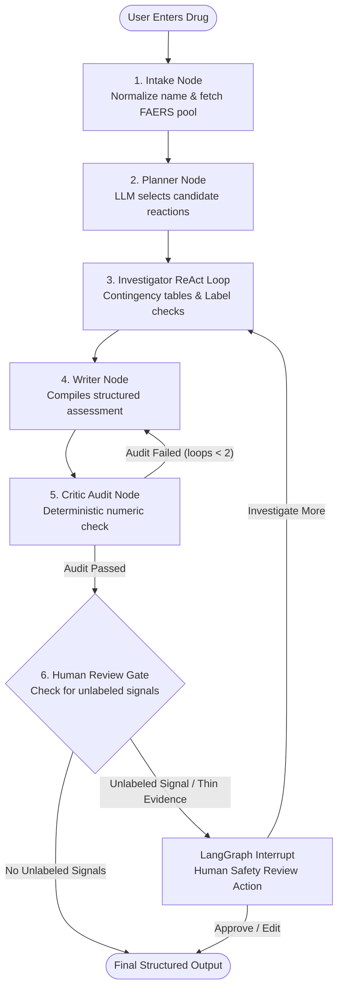

# Vigil AI 🔬
### Autonomous Agentic Drug Safety & Pharmacovigilance Assistant

Vigil AI is an agentic drug safety copilot that behaves like a junior safety scientist. It combines **LangGraph**, an **MCP server (FastMCP)**, and the **Groq API** with an editorial full-page snap-scroll web UI.

---

## 🏛️ Design Decisions

1. **Zero LLM Math (Stats in MCP Tools)**  
   Large language models are prone to hallucinating arithmetic and confidence intervals. In Vigil AI, **all calculations** (PRR, ROR, 95% Confidence Intervals, and Yates' Chi-square) are strictly computed by Python MCP tools. The LLM never invents, approximates, or recalculates statistical metrics.

2. **Autonomous Planning & ReAct Investigation**  
   Rather than investigating an arbitrary top-N list of symptoms, a clinical **Planner** node evaluates openFDA MedDRA frequencies and prioritizes clinically serious organ toxicities (e.g. rhabdomyolysis, pancreatitis, liver injury). The **Investigator** then queries contingency tables and package inserts.

3. **Conditional Deep Dives (Selective PubMed Search)**  
   PubMed literature searches are invoked **only** when a statistically flagged signal (Evans criteria: $PRR \ge 2$, $a \ge 3$, $\chi^2 \ge 4$) is **absent** from the official FDA drug label, discovering prospective safety concerns without unnecessary token spend.

4. **Self-Correction & Dual Critic Loop**  
   A dedicated **Critic** pass runs a numeric validator ensuring every number in the drafted assessment exists in tool outputs, verifies citations, and confirms mandatory limitations. If inaccuracies exist, the critic routes back to revise (up to 2 loops).

5. **Human-in-the-Loop (HITL) Review Gate**  
   Whenever an unlabeled signal or thin reporting volume is flagged, LangGraph's `interrupt()` halts graph execution. The clinician can approve, edit, or request deeper investigation before final assessment delivery.

---

## 🔄 LangGraph Workflow Architecture



---

## 🛠️ MCP Server Tools (`mcp_server`)

All tools return exact source URLs or queries for traceability and citation:

| Tool | Parameters | Description | Data Source |
|---|---|---|---|
| `search_faers_reactions` | `drug: str, limit: int = 15` | Retrieves top MedDRA reaction terms and report counts. Fallbacks: generic $\to$ brand $\to$ medicinal product. | openFDA `event.json` |
| `get_faers_totals` | `drug: str, reaction: str` | Computes $2 \times 2$ contingency table counts ($a, b, c, d$) using total reports. | openFDA `event.json` |
| `compute_disproportionality` | `a: int, b: int, c: int, d: int` | Calculates PRR, ROR, 95% CIs, Chi-square with Yates' correction, and Evans signal flag ($PRR \ge 2, a \ge 3, \chi^2 \ge 4$). | Local Python Math |
| `get_label_sections` | `drug: str` | Fetches Boxed Warning, Warnings & Precautions, and Adverse Reactions. | openFDA `label.json` |
| `check_reaction_in_label` | `drug: str, reaction: str` | Checks if term exists in package insert; returns section and verbatim snippet ($< 500$ chars). | openFDA `label.json` |
| `search_pubmed` | `query: str, max_results: int = 5` | Searches biomedical literature using NCBI E-utilities (esearch + efetch). | PubMed NCBI |

---

## ⚡ Quick Start

### 1. Requirements & Environment
- Python 3.11+
- Groq API Key (from [console.groq.com](https://console.groq.com/keys))

```bash
git clone <repo-url>
cd safetys

# Install dependencies
pip install -r requirements.txt

# Configure environment variables
cp .env.example .env
# Edit .env and insert your GROQ_API_KEY
```

### 2. Launch Services
Start both the FastMCP server and FastAPI application with a single command:
```bash
python run.py
```
- **Web UI & API:** `http://localhost:8000`
- **FastMCP SSE Transport:** `http://127.0.0.1:8001/sse`

---

## 🧪 Automated Test Suite

Run the full pytest suite:
```bash
python -m pytest tests/ -v
```

Tests include:
1. `tests/test_stats.py`: Hand-checked benchmark validation of PRR, ROR, Yates' $\chi^2$, and Evans criteria.
2. `tests/test_mcp_tools.py`: Mocked openFDA and PubMed E-utilities tests with generic/brand fallbacks.
3. `tests/test_graph.py`: End-to-end graph test verifying that unlabeled signals trigger the `human_review` interrupt and resume cleanly.
4. `tests/test_llm_resilience.py`: Simulated Groq 429 rate-limit backoff and malformed tool-call retries.
5. `tests/test_api_sse.py`: Server-Sent Events stream validation verifying chronological delivery of pipeline steps.

---

## 📁 Repository Structure

```
├── mcp_server/              # FastMCP Server
│   ├── server.py            # FastMCP tools & SSE transport app
│   ├── stats.py             # Disproportionality & Evans calculations
│   ├── openfda_client.py    # openFDA API client with exponential backoff
│   └── pubmed_client.py     # NCBI PubMed E-utilities client
├── agent/                   # LangGraph Agent Core
│   ├── state.py             # Typed Pydantic AgentState & schemas
│   ├── llm.py               # Centralized Groq LLM factory & resilience
│   ├── guardrails.py        # Deterministic numeric & citation validator
│   ├── mcp_client.py        # langchain-mcp-adapters loader
│   └── graph.py             # LangGraph StateGraph (intake->planner->investigator->writer->critic->HITL)
├── api/                     # FastAPI Backend
│   ├── app.py               # Main application & static file mount
│   └── routes.py            # Endpoints: /api/runs, /events (SSE), /review
├── static/                  # Minimalist Snap-Scroll Frontend
│   ├── index.html           # Full-viewport UI
│   ├── css/style.css        # Minimalist typography, magnetic scroll-snap
│   └── js/app.js            # SSE streaming & review interactions
├── tests/                   # Comprehensive Unit & Integration Tests
├── data/                    # Saved example runs (Atorvastatin, Ozempic)
├── run.py                   # Multi-service launcher
├── requirements.txt
├── .env.example
├── Dockerfile
└── README.md
```

---

## 🔒 Pharmacovigilance Disclaimer
Vigil AI is an educational and technological demonstration of agentic workflows. FAERS consists of voluntary, spontaneous reports and cannot establish biological causality or calculate incidence rates. Not for direct clinical diagnosis.

